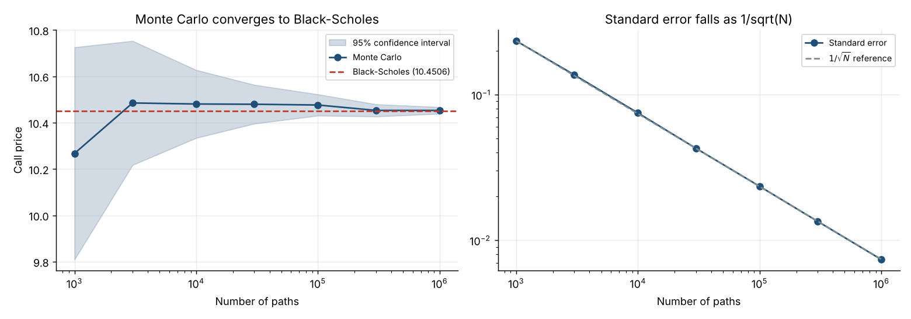
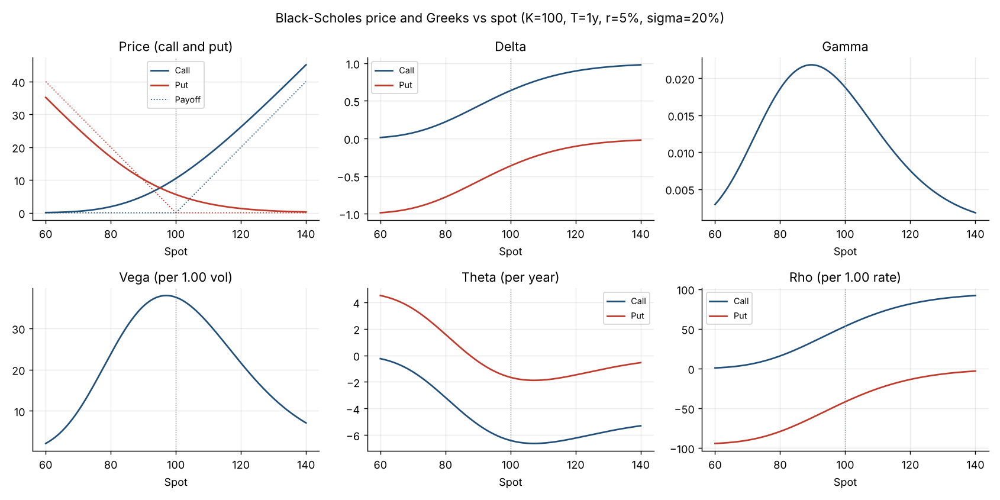

# Option Pricing: Black-Scholes vs Monte Carlo

Pricing of European options with the Black-Scholes-Merton formula and with Monte Carlo simulation, with Greeks, implied volatility, variance reduction and an Asian option that has no exact formula.



## What it does

- **Black-Scholes-Merton**: European call and put prices with a continuous dividend yield
- **Greeks**: delta, gamma, vega, theta and rho, checked against finite differences
- **Implied volatility**: Brent root-finding with a no-arbitrage check on the input price
- **Monte Carlo (GBM, risk-neutral)**: price with standard error and 95% confidence interval, reproducible with a seed
- **Pathwise Greeks**: Monte Carlo delta and vega without re-simulation, compared to Black-Scholes
- **Variance reduction**: antithetic variates for vanilla options, geometric-Asian control variate for arithmetic Asian options
- **Convergence study**: error and standard error against the number of paths, showing the 1/sqrt(N) rate

## Sample results

Inputs: S = K = 100, T = 1 year, r = 5%, sigma = 20%.

| | Black-Scholes | Monte Carlo (1M paths) | Std error |
|---|---|---|---|
| Call | 10.4506 | 10.4529 | 0.0074 |
| Put | 5.5735 | 5.5738 | 0.0047 |

| Call delta / vega | Black-Scholes | Monte Carlo pathwise |
|---|---|---|
| Delta | 0.6368 | 0.6368 +/- 0.0006 |
| Vega | 37.524 | 37.547 +/- 0.076 |

Variance reduction at 100k paths:

| Estimator | Plain | Reduced | Gain |
|---|---|---|---|
| European call, antithetic | 0.0464 | 0.0232 | 2x |
| Arithmetic Asian call, control variate | 0.0257 | 0.0007 | 36x |

The arithmetic Asian call (about 5.86) has no closed form; the control variate is the geometric Asian option, whose exact price is known.



## Quick start

```bash
pip install -r requirements.txt
python -m optionpricing        # prints the tables above and regenerates docs/*.png
pytest
```

```python
from optionpricing import bs_price, bs_greeks, implied_volatility, mc_european

bs_price(100, 100, 1.0, 0.05, 0.20, "call")            # 10.4506
bs_greeks(100, 100, 1.0, 0.05, 0.20, "call")["delta"]  # 0.6368
mc_european(100, 100, 1.0, 0.05, 0.20, "call", n_paths=1_000_000, seed=42).ci95
implied_volatility(10.4506, 100, 100, 1.0, 0.05, "call")
```

## Project structure

```
optionpricing/blackscholes.py   Pricing, Greeks, implied volatility, put-call parity
optionpricing/montecarlo.py     European and Asian Monte Carlo, pathwise Greeks, convergence table
optionpricing/report.py         Figures
tests/test_pricing.py           32 tests
```

## Testing

Tests compare the code with independent references: textbook prices (10.4506 / 5.5735), put-call parity, finite-difference Greeks, implied-volatility round trip, Monte Carlo estimates within 4 standard errors of Black-Scholes, the 1/sqrt(N) error rate, the closed-form geometric Asian price against simulation, and basic ordering (arithmetic Asian above geometric, below the vanilla call).

## Conventions and limits

- Vega is per 1.00 of volatility and rho per 1.00 of rate; divide by 100 for the usual per-1% quote. Theta is per year; divide by 365 for per day.
- Constant volatility and rate, no jumps, no stochastic volatility, European exercise only (no American options).
- Asian options are discretely monitored on equally spaced dates.

## Stack

Python · NumPy · SciPy · pandas · Matplotlib · pytest
